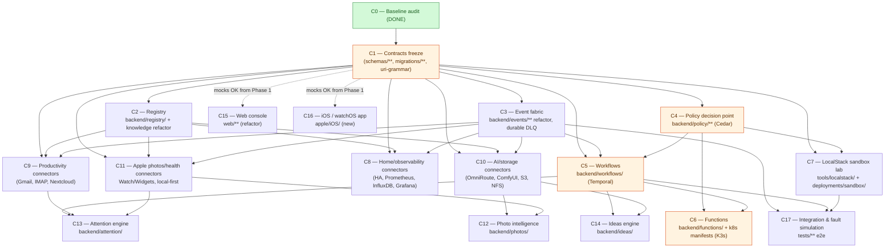

# NerveCenter — Workstream Dependency DAG

**Spec:** NC-SPEC-2026-010 · **Deliverable:** C0-D3a · **Status:** derived from
`specs/nervecenter-aws-platform/plan.md` (Phase 0 C0 → Phase 1 contracts freeze →
Phase 2 core C2/C4/C3 → Phase 3 runtime C5/C6 → Phase 4 connectors C8–C12 →
Phase 5 experience C13–C16 → Phase 6 LocalStack lab C7 → Phase 7 integration C17;
tasks T001–T030).

Companion document: [file-ownership-map.md](./file-ownership-map.md).
Preceding ADRs (authoritative for the technical choices referenced below):
ADR-0001 (registry / `nc://` URIs), ADR-0002 (event fabric), ADR-0003 (Cedar PDP),
ADR-0004 (Temporal), ADR-0005 (K3s functions), ADR-0006 (LocalStack sandbox),
ADR-0007 (connectors as adapters), ADR-0008 (photo/health local-first),
ADR-0009 (attention).

> **Precedence note:** C1 (the contracts-freeze workstream) is a hard entry
> dependency for everyone. Edges are *start* gates: a workstream may begin
> only after every upstream node is done. Soft/mock-only relationships are
> explicitly called out and do **not** gate.

---

## 1. Graph

---

## 2. Critical path

**`C1 → C4 → C5 → C6`** is the gating spine of the platform:

1. **C1** freezes the nc:// grammar, entity/event schemas, and policies every
   downstream service serializes against (ADR-0001, ADR-0002, ADR-0003).
2. **C4** replaces the no-op permission enforcer
   (`backend/policy/permissions.py:_get_subject_level` returning
   `default_level` unconditionally, lines 93–95) with the Cedar PDP (ADR-0003).
   Every later runtime gate — workflow activities (C5), function launches (C6),
   sandbox labs (C7) — routes security through this PDP.
3. **C5** builds the Temporal workflow layer (ADR-0004), which serializes
   activity calls against frozen contracts and consults C4 before any
   side effect.
4. **C6** adds K3s function execution (ADR-0005), the only new *untrusted
   execution surface* in the system, and therefore must close last on the
   spine.

**C7 (LocalStack lab, ADR-0006)** joins the critical path structurally
(needs C1 + C4) but is explicitly *excluded* by the plan — it is a test
harness, not a production artifact, so it may finish after C6.

**C15/C16 escape the spine:** both depend only on C1, may start at Phase 1
end against contract mocks, and have no serialization behind the UI
(what "no serialization behind UI" means here: nothing in the console or
mobile experience requires a serialized state machine that would block
UI work — every UI data source is a plain JSON API, so C15 and C16 can
run in parallel against fixtures until their real backends exist).

---

## 3. Edge register (rationale)

| Edge | Why |
|---|---|
| C0 → C1 | Baseline audit (this deliverable) precedes the design freeze. |
| C1 → C2 | Registry endpoints and `nc://` URI resolution encode exactly the grammar + entity schema shapes frozen in C1 (ADR-0001). |
| C1 → C3 | Event envelope + durable DLQ record shapes (ADR-0002) are frozen first; consumers of the envelope (connectors, workflows) then code against them. |
| C1 → C4 | Cedar PDP (ADR-0003) operates over the frozen resource/subject model. No policy decision can be typed without it. |
| C1 → C5 / C3 → C5 / C4 → C5 | Temporal adapters (ADR-0004) must (a) serialize activity payloads against frozen contracts, (b) observe via the event fabric, (c) check PDP before side effects. **All three** are hard gates. |
| C4 → C6 | K3s function launches (ADR-0005) are governed by the PDP; an ungated launch surface is a security regression. |
| C5 → C6 | Functions are *invoked from* workflow activities (C6 has no standalone entry point). |
| C1 → C7 / C4 → C7 | ADR-0006: LocalStack lab needs the same resource models and must prove Cedar PDP decisions *against* the emulated service, so it runs in lock-step with C4. |
| C1 → C8 / C2 → C8 / C3 → C8 | Connectors (ADR-0007): every connector (a) emits events (C3 fabric), (b) resolves entities via `nc://` (C2 registry), (c) serializes payloads against frozen schemas (C1). Home/observability subset. |
| C1 → C9 / C2 → C9 / C3 → C9 | Same triple for productivity connectors (Gmail/IMAP/Nextcloud). |
| C1 → C10 / C2 → C10 / C3 → C10 | Same triple for AI/storage connectors (OmniRoute, ComfyUI, S3, NFS). Note: C10's `backend/connectors/omniroute.py` is the module referenced by the currently-dead import at `backend/connectors/registry.py:502` — the import stays dead until C10 lands (see §4). |
| C1 → C11 / C2 → C11 / C3 → C11 | Apple photos/health connectors (ADR-0008, local-first): Watch/Widgets resolve entities and emit events; same freeze applies. |
| C10 → C12, C11 → C12 | Photo intelligence requires *both* an inference/storage path (OmniRoute/ComfyUI + S3/NFS from C10) **and** the local-first photo source (C11). |
| C5 → C13, C9 → C13, C11 → C13 | Attention engine (ADR-0009) is a workflow (C5) *over* productivity signals (C9: Gmail/IMAP/Nextcloud) with watch/phone presence (C11). |
| C5 → C14, C10 → C14 | Ideas engine is a workflow (C5) that calls AI connectors (C10: OmniRoute/ComfyUI) for generation + storage. |
| C1 → C15 (soft) | Web console consumes the frozen OpenAPI contract only; **mocks may stand in from Phase 1** — no serialization behind the UI. |
| C1 → C16 (soft) | iOS/watchOS app consumes the same frozen contract. Same escape. |
| C3 → C17, C5 → C17, C7 → C17 | Integration/fault simulation must (a) observe the real event fabric, (b) drive real workflows, (c) exercise the emulated cloud. All three are hard gates. |

---

## 4. Pre-assigned defects (fix-first, owned by workstream)

Pre-assigned so two workers never touch the same defect; full rule in
[file-ownership-map.md §4](./file-ownership-map.md#4-pre-assigned-defects-two-worker-one-file-rule):

| Defect | Owner | Location |
|---|---|---|
| Dead-import block (incl. `.omniroute`) | **C2** | `backend/connectors/registry.py:497-503` |
| No-op permission enforcer | **C4** | `backend/policy/permissions.py:93-95` |
| Inference wiring | **C4/C10** | `backend/inference/omniroute.py` (adapter) wired through PDP (C4) *and* OmniRoute connector (C10) — split by file, not by line |
| MCP auth | **C4** | `mcp/auth.py` |
| Trace header propagation | **C3** | `backend/events/**` envelope + `backend/api/observability.py` |

> **Note:** the C2 fix to `registry.py:497-503` *removes the import
> dependency* without creating the module — the module itself
> (`backend/connectors/omniroute.py`) is C10's. C2 must therefore make
> registration **lazy / registry-driven** (ADR-0007 connector-as-adapter)
> rather than importing every connector at module load; this is what
> lets C10 land its module without re-editing C2's file.

---

## 5. Parallel execution groups (from Phase 1 end)

Once **C1** completes, the following can start in parallel without
further gates on each other:

- **Spine:** C4 → (C5 → C6)
- **Lateral:** C7 (with C4), C8, C9, C10, C11, C15, C16 — all independent of
  each other on the current DAG
- **Late:** C2 (unblocks C8–C11 in series with C1), C3 (unblocks C5 with
  C1/C4, and C8–C11 with C1/C2), C12–C14, C17

This matches the plan's phasing: Phase 2 is `C2 / C4 / C3` in parallel;
Phase 3 is `C5 / C6`; Phase 4 is `C8–C12`; Phase 5 is `C13–C16`;
Phase 6 is `C7`; Phase 7 is `C17`.
